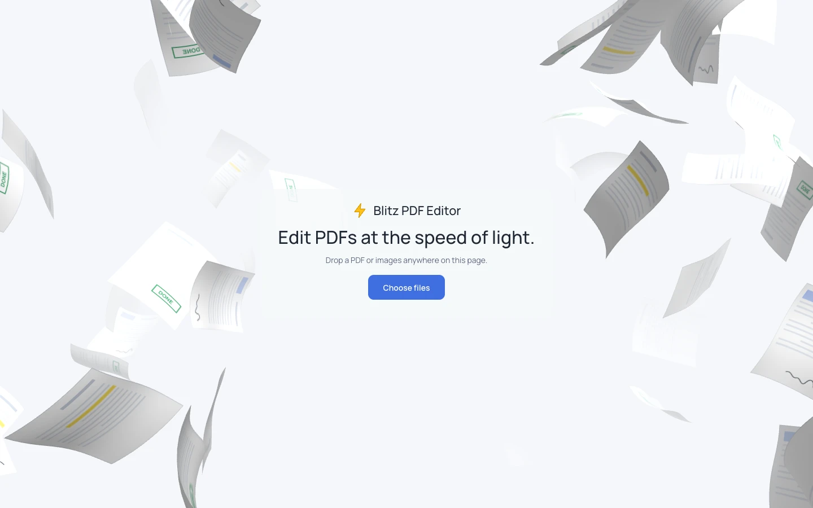
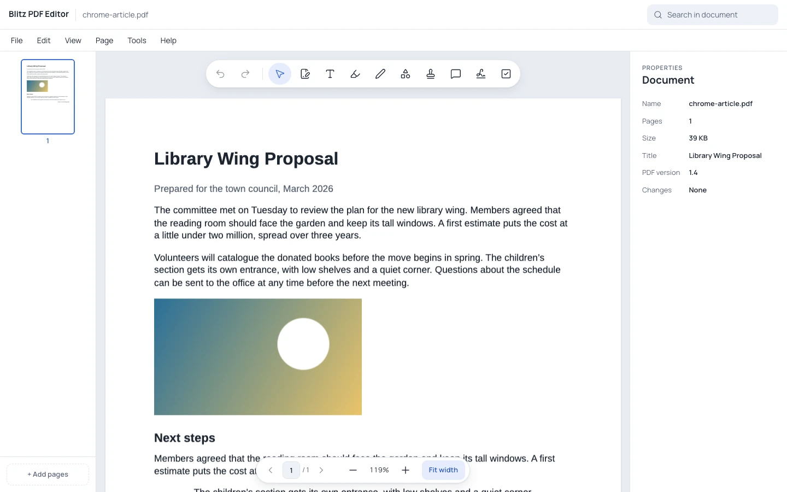
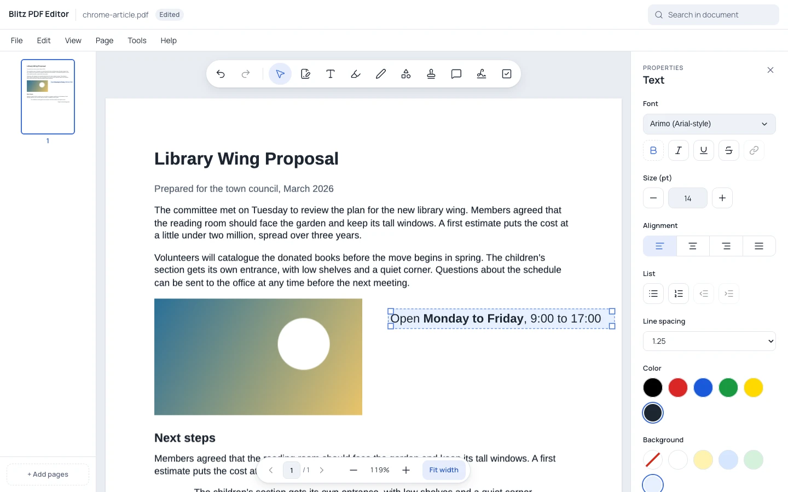
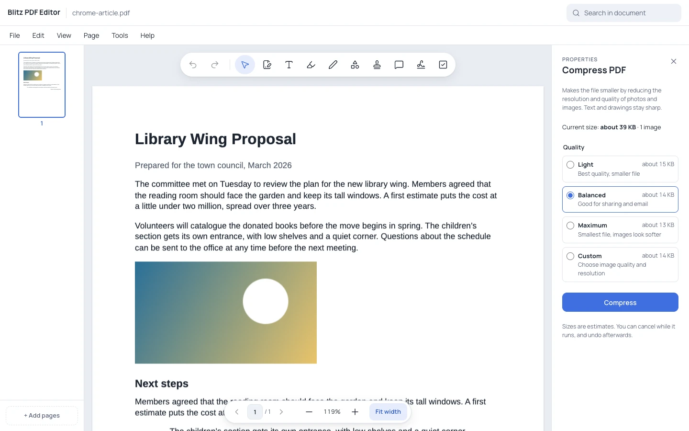

# Blitz PDF Editor

Edit PDFs at the speed of light.

Blitz is a PDF editor that runs in your browser and never uploads your files.



## Why Blitz

- **Private by design.** Your files are opened and saved on your own device. Nothing is sent to a server.
- **No account and no subscription.** Open the page and start editing.
- **One simple screen.** A small toolbar, a page in the middle and the options for what you selected on the right, instead of rows of buttons.

## What you can do



**Pages**

- Rotate, delete, reorder (drag the thumbnails), extract and crop pages
- Insert blank pages, pictures as pages, or pages from another PDF
- Add page numbers

**Markup**

- Highlight text, draw, add shapes and arrows, stamps and comments
- Sign with a drawn, typed or uploaded signature
- Fill in PDF forms, then flatten them so the answers can't be changed

**Text**

- Add text boxes in 15 fonts, with bold, italic, underline, size, colour, alignment, line spacing and a background colour
- Format single words differently, add links (web, email, phone or another page) and bulleted or numbered lists



**Images**

- Insert pictures by choosing, dropping or pasting them; move, resize, rotate, flip and fade them
- Crop pictures; only the part you keep is saved

**Arranging**

- Select several objects, group them and change their order (bring to front, send back)
- Copy, paste and duplicate; smart guides help you line things up, and **View › Show margins** keeps objects inside the page margins

**The PDF's own content**

- Select text blocks and pictures that are part of the PDF itself, and delete them for real
- Turn a block of the PDF's text into a text box you can change

**Tools**

- Compress, merge, split, and protect with a password (or remove it)
- Add a watermark, make scanned pages searchable (OCR, English and Croatian), compare two PDFs, and redact (black out and remove) content
- Create a new blank PDF or a PDF from pictures; export pages as pictures or the text as plain text; print



## Try it

1. Open a PDF: drop it anywhere on the page, or press **Choose files**.
2. Make your changes with the toolbar and the panel on the right. Changes can be undone until you close the document.
3. Save: **File › Save** downloads the edited PDF. Your original file is never changed.

## Your files stay yours

Your files are read, edited and saved in the browser tab, and are never uploaded. The app makes no requests to anyone but the site it is served from (checked by recording every request in a test session that opened, edited, compressed, saved and OCR'd files). Nothing is kept in the browser after you close the tab: no cookies and no local storage.

## Questions

**Is anything uploaded?**
No. The only requests go to the site serving the app, for the app itself and for parts it loads when first needed (fonts, the OCR engine).

**Does it work offline?**
Not as an offline app. It needs its site to load, and fetches fonts and the OCR engine from it the first time you use them. Working without a connection hasn't been tested.

**Which browsers are supported and tested?**
The automated tests run in Google Chrome, on a desktop and at phone size. It's built for current Chrome, Edge, Firefox and Safari, but only Chrome is tested.

**What about phones?**
Narrow screens get a phone layout: a top bar, a menu, a tool strip and a bottom panel. It's tested at phone size in Chrome, not on real phones.

**How big a file can it open?**
Any size your device can handle. Above about 500 MB (120 MB on phones and devices with little memory), it asks before opening.

**What can it not do yet?**
See the limitations below.

## Known limitations

- Changing the PDF's own text uses a replacement font (Arimo, Tinos or Cousine, the closest match). Serif text can space out slightly differently.
- Turned or vertical text, superscripts and subscripts can only be deleted, not changed. Lines and shapes from the original PDF can't be edited.
- Scanned pages are pictures: OCR makes them searchable and copyable, but their text still can't be edited.
- Editing a digitally signed PDF invalidates its signature (the app warns first). The signatures you add are pictures, not certificate-based digital signatures.
- Files that use XFA forms can only be shown properly in Adobe Acrobat.
- Using fonts installed on your computer works only in Chrome and Edge on a desktop. HEIC photos open only where the browser supports them (Safari).
- There is no export to Word.

## Run it on your computer

You need [Node.js](https://nodejs.org) 24 (22.12 or newer works) and npm, which comes with it. Check with `node -v`.

1. Get the code and go into its folder:

   ```bash
   git clone https://github.com/lovromaricic/blitz-pdf-editor.git
   cd blitz-pdf-editor
   ```

2. If you use nvm, switch to the right Node version (it reads `.nvmrc`):

   ```bash
   nvm use
   ```

3. Install the dependencies (only the first time, and after they change):

   ```bash
   npm ci
   ```

4. Start the app:

   ```bash
   npm run dev
   ```

5. Open http://localhost:5173 in your browser. Changes to the code show up as you save them. Press **Ctrl+C** in the terminal to stop.

To run the finished build the way it would be served on a website, use `npm run build` and then `npm run preview`, and open the address it prints (http://localhost:4173).

<details>
<summary><strong>For developers</strong></summary>

### Requirements

Node 24 (see `.nvmrc`; `package.json` allows 22.12 or newer) and npm.

### Commands

```bash
npm ci                  # install
npm run dev             # dev server at http://localhost:5173
npm run check           # type check (svelte-check)
npm test                # unit tests (Vitest)
npm run e2e             # browser tests (Playwright, uses the installed Google Chrome)
npm run build           # production build into dist/
npm run preview         # serve the build locally
npm run screenshots     # regenerate the README screenshots
```

### Stack

Svelte 5 and TypeScript on Vite; PDF.js renders pages, pdf-lib writes PDFs (in Web Workers), ProseMirror handles typing, Tesseract.js does OCR and Three.js draws the landing background. Everything is bundled: no CDNs, no analytics.

### Screenshots

Each picture is an entry in `build-tools/screenshots.config.ts` (its size and the steps that set up the scene). `npm run screenshots` makes them all into `docs/screenshots/`, and `npm run screenshots -- --only <id>` makes one. A file with the same name in `docs/screenshots/custom/` is used as it is instead.

### Folders

| Folder | What's in it |
|---|---|
| `src/` | The app: screens, editor components and the logic behind them (`src/lib/`) |
| `tests/` | Unit tests |
| `e2e/` | Browser tests |
| `test-fixtures/` | Sample PDFs generated by `build-tools/content-fixtures.ts`, used by tests and screenshots |
| `build-tools/` | Build plugins, the fixture generator and the screenshot generator |
| `docs/` | Research notes, design references and the screenshots |

### Deploying

The build is a plain static folder with no server code. Run `npm run build` and upload the contents of `dist/` to any web host, served over HTTPS. Asset paths are relative, so it works from a subfolder too (`BASE_PATH=/tools/pdf/ npm run build` for absolute paths). Serve `.mjs` as `text/javascript` and `.wasm` as `application/wasm`, and serve the OCR files (`.traineddata.gz`) as they are. `dist/THIRD_PARTY_LICENSES.txt` holds the licences of the bundled libraries; keep it with the app.

</details>

## Roadmap

- Preferences (theme, default font and colour, the 3D background on or off), remembered only if you opt in
- Export to Word
- Editing lines and shapes in the PDF's own content
- A "Report a problem" link in the Help menu
- Testing in Firefox, Safari and on real phones

## License

All rights reserved. This is a private project.
